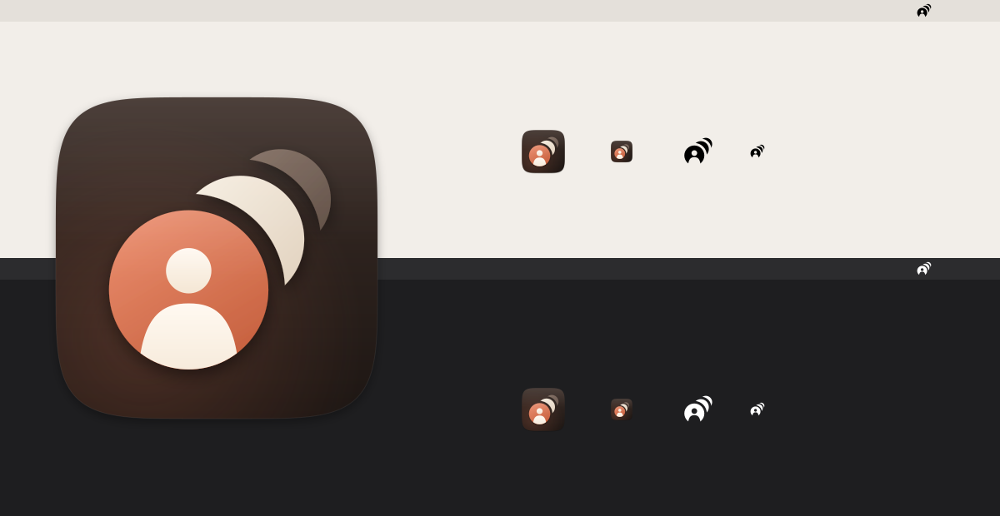

<p align="center"></p>

<h1 align="center">Claude Hesap</h1>

<p align="center">Birden fazla Claude hesabı arasında tek tıkla geçiş — <code>fvm</code> mantığında, macOS için.</p>

Claude Code'da ve Claude masaüstü uygulamasında hangi hesabın açılacağını seçersin. Düz `claude` komutu her zaman seçtiğin hesapla açılır; ayrı `CLAUDE_CONFIG_DIR` takma adlarıyla uğraşmazsın.

- **Varsayılan hesabı değiştir:** pencereden, menü çubuğundan ya da `claude-hesap use iş` ile.
- **Limitleri gör:** her hesabın 5 saatlik ve haftalık kullanım yüzdesi, sıfırlanma zamanıyla.
- **Claude masaüstü de geçer:** uygulama kapatılır, hedef hesabın oturumu yerine konur, yeniden açılır. Her hesap için ilk seferde bir kez giriş yaparsın.
- **Hesap ekle:** yeni hesap ayrı bir dizinde `claude auth login` ile eklenir.

## Kurulum

```sh
brew install --cask slymnyg/tap/claude-hesap
```

Uygulama `/Applications/Claude Hesap.app` olarak, komut satırı aracı `claude-hesap` olarak kurulur. macOS 14 (Sonoma) ve üstü gerekir.

Güncelleme: `brew upgrade --cask claude-hesap`

> Uygulama Apple Developer ID ile imzalanmadığı için cask kurulumdan sonra karantina işaretini kaldırır. Kaynaktan kurmak istersen aşağıya bak.

### Kaynaktan

```sh
git clone https://github.com/slymnyg/claude-hesap && cd claude-hesap
./build.sh   # ~/Applications/Claude Hesap.app + ~/.local/bin/claude-hesap
```

Xcode komut satırı araçları (Swift 5.9+) yeterli.

## Komut satırı

```
claude-hesap list          hesapları listele (● varsayılan)
claude-hesap use <ad>      varsayılan hesabı değiştir (ad ya da e-posta)
claude-hesap current       varsayılan hesabı göster
```

## Nasıl çalışır

Claude Code oturumları macOS Keychain'de durur: varsayılan hesap `Claude Code-credentials`, `CLAUDE_CONFIG_DIR` ile açılan her dizin kendi kaydında. Claude Hesap her hesabı bir dizinle (`~/.claude-<ad>`) eşler ve geçişte:

1. `~/.claude.json` dosyasını `~/.claude-hesap/backups` altına yedekler,
2. o anki varsayılanın token'ını kendi dizininin kaydına geri yazar,
3. hedef hesabın token'ını ve hesap bilgisini varsayılana koyar.

MCP bağlantıları ve ayarlar hesaplar arasında ortak kalır. Açık `claude` oturumları eski hesapla devam eder; yeni açılanlar yeni hesabı kullanır.

Claude masaüstü için oturum çerezleri ve token önbelleği `~/.claude-hesap/desktop/<hesap>` altında saklanır. Geçişte Claude.app yeniden başlar, açık sohbetler kapanır. Pencerenin altındaki **Masaüstünü de geçir** anahtarıyla bu kapatılabilir.

Hiçbir veri üçüncü bir sunucuya gönderilmez; uygulama yalnız Anthropic'in kendi API'leriyle (limit sorgusu, token yenileme) konuşur.

## Uyarı

Bu proje Anthropic ile bağlantılı değildir ve Claude'un iç dosya düzenine dayanır; Claude Code ya da Claude masaüstünün bir güncellemesi onu bozabilir. Kendi sorumluluğunda kullan.

## Lisans

MIT
